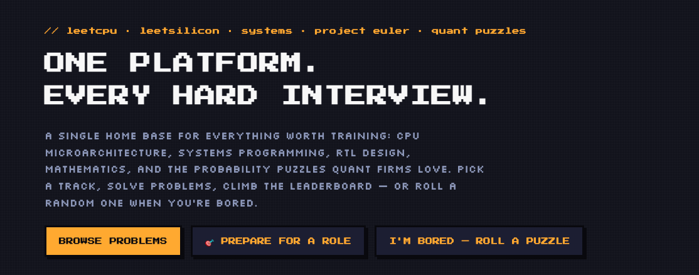

# Interview Red



**Play with it live**

- <https://personal-interview-training.vercel.app>
- <https://x-curiosity.github.io/Personal_Interview_Training/>

**Interview Red** is a pixel art training platform with **520 problems** across ten tracks: CPU architecture, silicon/RTL, FPGA implementation, systems C/C++, machine learning, Python algorithms, high performance computing, mathematics, quant puzzles, and company interview questions.

Five **build arcs** turn individual problems into whole systems. Each arc is an ordered series where every step is a real module of the final design, and the tests only rely on the contract you already built:

| Arc | Language | What you end up with |
|---|---|---|
| CPU simulator | C | Decoder, ALU and register file, byte-addressed memory, the full instruction step, then a cache that turns instructions into cycles |
| Edge detector | Verilog | Streaming ISP front end: RGB to luma, line buffer, Sobel, threshold, integrated block with handshake |
| FPGA bring-up | Verilog | Heartbeat, two-flop synchronizer and debouncer, UART transmit and receive with framing errors, loopback top |
| Stack VM | Python | Tokenizer, Pratt parser, bytecode compiler, VM loop, functions and recursion |
| HPC kernel suite | Python | Blocked multiply, tiled transpose, halo exchange, parallel reduction, roofline report |

Difficulty runs **Easy 1, Medium 3, Hard 5, Very hard 8** points. Math, probability and interview practice deliberately start at Medium: the recall drills were retired in favour of depth, and the very hard tier is reserved for exact derivations.

Verilog problems can show **waveforms**: the runner returns a value-change dump and the site draws an interactive timing diagram, clocks highlighted, buses as hex boxes, wheel to zoom, drag to pan, and a `.vcd` download. This needs a connected simulator (see `runner-service/`), because a static site cannot simulate Verilog by itself.

Create a free profile to sync progress across devices and join the global leaderboard. Solving is earned by correct submissions only, hints are free, and viewing a solution forfeits credit for that problem. Twelve standalone project problems (cache simulator, FIFO, arena allocator, arbiter, Karatsuba, Monte Carlo pricer and more) are multi-hour builds with full edge-case test suites.

## Run locally

```bash
cd Personal_Interview_Training
python3 -m http.server 8000
```

Open <http://localhost:8000>. Done. No build step, no dependencies.

## How to contribute

1. **Propose a problem** — use the [Contribute page](submit.html) on the site. It fills a pre formatted GitHub issue for review.
2. **Vote** — interview questions and pending submissions have accuracy votes; your votes decide what gets merged.
3. **Open a pull request** — problems live in `assets/js/data/pack_*.js`. Add yours to the right pack, then run:

```bash
npm install
npm test
node tools/gen_points.js   # after adding problems: refreshes server scoring
```

A few ground rules keep the database clean:

- The total is capped at **exactly 520 problems** — change the cap deliberately when adding verified content, rather than inflating it accidentally.
- Build-arc steps must name their contract, ship a skeleton that compiles but fails, and keep the reference implementation in `solution`; `npm test` re-verifies all 25 steps.
- Coding tasks need starter code and deterministic tests. The judge reports `ALL TESTS PASSED` only after those tests finish successfully.
- Answer tasks need a verified answer plus an explanatory solution.
- No GPU/CUDA content; the platform deliberately dropped that track.
- The test suite must pass before any merge.

## License

[MIT](LICENSE). Wikipedia links and Wikimedia images belong to their respective authors.
