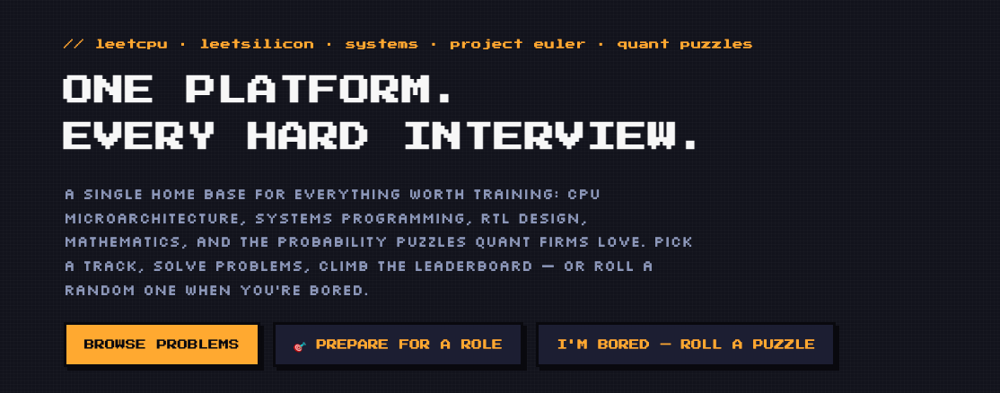

# Interview Red



**Play with it live**

- <https://personal-interview-training.vercel.app>
- <https://x-curiosity.github.io/Personal_Interview_Training/>

**Interview Red** is a pixel art training platform with **532 problems** across eight tracks: machine learning, Python algorithms, CPU architecture, systems C/C++, silicon/RTL, mathematics, quant puzzles, and company interview questions. Solve directly on the site with Python, C, C++, or Verilog.

The new ML and Python tracks include 12 detailed, original problems covering learning algorithms, evaluation, data preprocessing and classic coding interview patterns. They provide runnable Python tests, progressive hints and explanations. Related LeetCode or NeetCode links are for further reading; their problem text is not reproduced here.

Create a free profile to sync progress across devices and join the global leaderboard. Solving is earned by correct submissions only; hard problems offer free hints, but viewing a solution forfeits credit for that problem. Twelve **project problems** (cache simulator, FIFO, arena allocator, arbiter, Karatsuba, Monte Carlo pricer and more) are multi-hour builds with full edge-case test suites.

## Run locally

```bash
cd Personal_Interview_Training
python3 -m http.server 8000
```

Open <http://localhost:8000>. Done. No build step, no dependencies.

## How to contribute

1. **Propose a problem** — use the [Contribute page](submit.html) on the site. It fills a pre formatted GitHub issue for review.
2. **Vote** — interview questions and pending submissions have accuracy votes; your votes decide what gets merged.
3. **Open a pull request** — problems live in `assets/js/data/pack_*.js`. Add yours to the right pack, then run:

```bash
npm install
npm test
```

A few ground rules keep the database clean:

- The total is capped at **exactly 532 problems** — change the cap deliberately when adding verified content, rather than inflating it accidentally.
- Coding tasks need starter code and deterministic tests. The judge reports `ALL TESTS PASSED` only after those tests finish successfully.
- Answer tasks need a verified answer plus an explanatory solution.
- No GPU/CUDA content; the platform deliberately dropped that track.
- The test suite must pass before any merge.

## License

[MIT](LICENSE). Wikipedia links and Wikimedia images belong to their respective authors.
